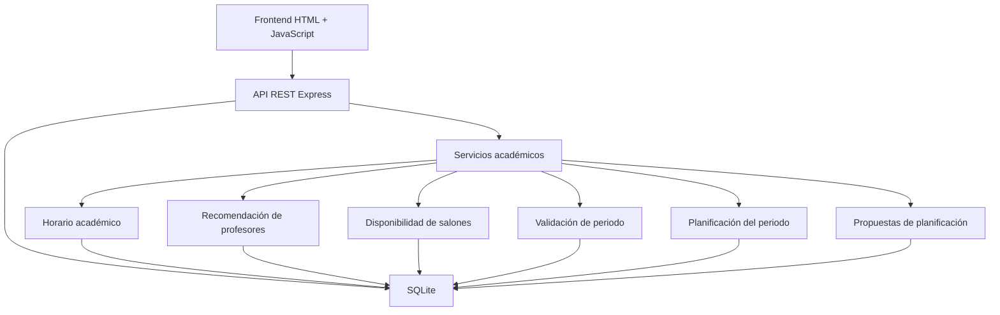

# NiceProject — Sistema de Gestión y Planificación Académica Inteligente

Proyecto académico desarrollado para la materia de **Desarrollo Rápido de Aplicaciones**.

NiceProject es un sistema web para gestionar información académica y apoyar la construcción de periodos escolares mediante reglas de disponibilidad, carga docente, compatibilidad de salones, horarios y recomendaciones explicables.

> **Principio del sistema:** el sistema recomienda; el gestor toma la decisión final.

---

## Estado actual

Checkpoint estable más reciente:

`v1.1.0-planificacion-inteligente`

NiceProject actualmente permite trabajar desde la administración básica de profesores y academias hasta la planificación asistida de un periodo académico completo.

La aplicación no publica ni asigna automáticamente una recomendación. Las propuestas se muestran al gestor y solo se convierten en cursos cuando este las acepta explícitamente.

---

# Funcionalidades principales

## Gestión académica

El sistema permite administrar:

- Profesores.
- Academias.
- Materias.
- Grupos.
- Salones.
- Franjas horarias.
- Cursos.
- Periodos académicos.
- Evaluaciones docentes.
- Horarios.

También conserva compatibilidad con estructuras utilizadas en las primeras versiones del proyecto.

---

## Profesores

Cada profesor puede registrar información como:

- Número de empleado.
- Nombre y apellido.
- Especialidad.
- Licenciatura.
- Maestría.
- Doctorado.
- SNI.
- Perfil PRODEP.
- Academia.
- Carga máxima semanal.

El sistema también permite asociar:

- Materias impartidas.
- Calificación específica profesor–materia.
- Disponibilidad horaria.

---

## Calificación profesor–materia

La tabla:

`profesor_materia_calificaciones`

permite registrar una calificación de `0` a `10` para representar qué tan adecuado es un profesor para impartir una materia específica.

Esta información se utiliza para ordenar las recomendaciones.

Ejemplo conceptual:

```text
Bases de Datos

Perry Santry        10/10
Lind Hateley         9/10
Dav Dent             7/10
```

Las evaluaciones docentes generales almacenadas en `evaluaciones` son independientes de esta calificación específica.

---

# Materias y horas semanales

Cada materia contiene un valor:

`horasSemanales`

Actualmente se admiten:

- 4 horas.
- 5 horas.
- 6 horas.

NiceProject utiliza estas horas para generar patrones académicos automáticamente.

---

## Patrones horarios

### Materias de 4 horas

Patrón:

`2 + 2`

Ejemplos:

```text
Lunes      07:00–09:00
Miércoles  07:00–09:00
```

o:

```text
Martes     07:00–09:00
Jueves     07:00–09:00
```

---

### Materias de 5 horas

Patrón:

`2 + 2 + 1`

Ejemplo:

```text
Lunes      07:00–09:00
Miércoles  07:00–09:00
Viernes    08:00–09:00
```

También existe la variante:

```text
Martes
Jueves
Viernes
```

El bloque del viernes utiliza una franja de una hora.

---

### Materias de 6 horas

Patrón:

`2 + 2 + 2`

Ejemplo:

```text
Lunes      07:00–09:00
Miércoles  07:00–09:00
Viernes    07:00–09:00
```

La generación de estos patrones se encuentra centralizada en:

`backend/services/horario-academico.js`

---

# Periodos académicos

NiceProject permite crear y administrar periodos académicos.

Estados disponibles:

```text
BORRADOR
VALIDADO
PUBLICADO
CERRADO
```

## BORRADOR

Permite:

- Crear cursos.
- Modificar cursos.
- Crear necesidades de planificación.
- Generar propuestas.
- Aplicar propuestas.

## VALIDADO

Representa un periodo revisado.

Puede consultarse y utilizarse para determinadas simulaciones, pero las nuevas asignaciones no deben aplicarse directamente.

## PUBLICADO

Representa una planificación publicada.

Las operaciones académicas de escritura quedan restringidas.

## CERRADO

Representa un periodo histórico finalizado.

Se utiliza principalmente para consulta.

---

# Cursos

Un curso representa una asignación académica completa.

Para existir necesita obligatoriamente:

- Materia.
- Profesor.
- Grupo.
- Salón.

Además puede asociarse a:

- Periodo académico.
- Estado.
- Una o varias franjas horarias.

Los horarios de los cursos se almacenan mediante:

`curso_horarios`

relacionando cada curso con las franjas de:

`franjas_horarias`

---

# Disponibilidad docente

La tabla:

`profesor_disponibilidad`

permite registrar disponibilidad por:

- Profesor.
- Día.
- Hora inicial.
- Hora final.

Al generar recomendaciones se verifica que el profesor:

- esté disponible;
- no tenga otro curso simultáneo;
- no supere su carga máxima.

---

# Carga docente

Cada profesor contiene:

`maxHorasSemanales`

El sistema calcula automáticamente su carga actual a partir de los cursos del periodo.

Se utiliza un umbral de advertencia del:

`80 %`

Ejemplo:

```text
Carga máxima:       20 h
Carga actual:       12 h
Carga propuesta:    16 h
Uso resultante:     80 %
```

En ese caso la propuesta puede seguir siendo válida, pero se muestra una advertencia.

Una propuesta que supere la carga máxima se considera incompatible.

---

# Salones

Los salones contienen:

- Clave.
- Nombre.
- Capacidad.
- Tipo.

Tipos actualmente admitidos:

```text
AULA
LABORATORIO
AUDITORIO
```

---

## Características de los salones

NiceProject puede registrar características como:

```text
COMPUTADORAS
INTERNET
PROYECTOR
RED_LOCAL
```

La relación se almacena en:

`caracteristicas_salones`

---

## Requisitos de las materias

Una materia puede requerir:

- Tipo específico de salón.
- Características específicas.

Esta información se almacena en:

`materia_requisitos_salon`

Ejemplo:

```text
Materia:
Redes

Tipo requerido:
LABORATORIO

Características:
COMPUTADORAS
RED_LOCAL
```

Una propuesta que no cumpla estos requisitos se descarta.

---

# Disponibilidad de salones

La tabla:

`salon_disponibilidad`

permite definir bloques en los que un salón puede o no utilizarse.

Al buscar un salón se comprueba:

- Capacidad.
- Tipo.
- Características.
- Disponibilidad.
- Conflictos con otros cursos.

La lógica se encuentra en:

`backend/services/disponibilidad-salones.js`

---

# Conflictos académicos

NiceProject detecta conflictos relacionados con:

- Profesor ocupado.
- Grupo ocupado.
- Salón ocupado.
- Profesor no disponible.
- Capacidad insuficiente.
- Tipo de salón incompatible.
- Características faltantes.
- Carga docente excedida.

El sistema dispone de una pantalla específica:

`frontend/conflictos.html`

y del servicio:

`backend/services/validacion-periodo.js`

---

# Planificación inteligente del periodo

Incorporada en:

`v1.1.0-planificacion-inteligente`

Esta fase permite planificar explícitamente qué materias deben impartirse a determinados grupos antes de crear los cursos.

---

## Necesidades de planificación

La tabla:

`necesidades_planificacion`

representa una necesidad académica:

```text
Periodo + Materia + Grupo
```

Ejemplo:

```text
Periodo: 2027-1
Materia: Bases de Datos
Grupo: Grupo A
Estado: PENDIENTE
```

Una necesidad no almacena directamente profesor, salón ni horarios.

Estos recursos se determinan posteriormente mediante las propuestas de planificación.

---

## Estados de una necesidad

### PENDIENTE

La necesidad todavía no tiene un curso asociado.

### ASIGNADA

La necesidad ya fue convertida en un curso completo.

### OMITIDA

La necesidad se excluye temporalmente del cálculo activo de planificación.

---

# Flujo de planificación

El flujo general es:

```text
Necesidad académica
Periodo + Materia + Grupo
          │
          ▼
Generar propuestas
          │
          ▼
Profesor + Horario + Salón
          │
          ▼
Comparar alternativas
          │
          ▼
Gestor selecciona una opción
          │
          ▼
Revalidación backend
          │
          ▼
Crear curso completo
          │
          ▼
Necesidad → ASIGNADA
```

---

# Generación de propuestas

El sistema puede generar hasta tres alternativas compatibles para una necesidad.

Cada alternativa puede mostrar:

- Profesor.
- Calificación profesor–materia.
- Carga docente actual.
- Carga resultante.
- Horarios.
- Patrón académico.
- Salón.
- Capacidad.
- Razones de recomendación.
- Advertencias.

La generación de propuestas es una operación de **solo lectura**.

No crea:

- Cursos.
- Reservas.
- Asignaciones.
- Cambios en necesidades.

---

# Ranking explicable

Las propuestas se ordenan utilizando criterios deterministas.

Prioridad actual:

1. Mayor calificación profesor–materia.
2. Menor porcentaje de carga docente resultante.
3. Menor cantidad de advertencias.
4. Profesor como criterio de desempate.
5. Salón como criterio de desempate.

No se utiliza una puntuación oculta para decidir automáticamente.

---

# Aplicación de una propuesta

Cuando el gestor acepta una propuesta, el backend vuelve a comprobar todo.

Se revalida:

- Periodo.
- Necesidad.
- Materia.
- Grupo.
- Profesor.
- Disponibilidad.
- Carga.
- Horarios.
- Salón.
- Capacidad.
- Tipo.
- Características.
- Conflictos.

Esto evita aplicar una recomendación que haya quedado obsoleta después de ser generada.

Si el contexto cambió se devuelve:

`409 Conflict`

---

## Aplicación atómica

Cuando una propuesta continúa siendo válida se ejecuta una transacción SQLite.

Dentro de la misma operación:

```text
1. Se crea el curso.
2. Se registran sus horarios.
3. La necesidad pasa a ASIGNADA.
4. Se vincula el curso con la necesidad.
```

Si uno de esos pasos falla:

```text
ROLLBACK
```

y no quedan datos parcialmente guardados.

---

# Panel de planificación

Pantalla:

`frontend/planificacion-periodo.html`

Incluye información como:

- Progreso del periodo.
- Necesidades pendientes.
- Necesidades asignadas.
- Necesidades omitidas.
- Conflictos.
- Carga docente.
- Ocupación de salones.
- Propuestas disponibles.

También permite administrar visualmente las necesidades.

---

## Progreso

El porcentaje se calcula mediante:

```text
asignadas
────────────────────────── × 100
asignadas + pendientes
```

Las necesidades `OMITIDA` no entran en el denominador.

---

# Diseño responsive

La pantalla de planificación fue comprobada aproximadamente en:

- 390 px.
- 768 px.
- 1366 px.

Los formularios, tarjetas, botones e indicadores se adaptan al ancho disponible.

---

# Arquitectura



---

# Tecnologías

## Backend

- Node.js.
- Express 5.
- CORS.
- `better-sqlite3`.

## Frontend

- HTML.
- JavaScript ES Modules.
- W3.CSS.

## Base de datos

- SQLite.
- Claves foráneas activadas.
- WAL habilitado.

---

# Estructura principal

```text
niceproject/
│
├── INICIAR_NICEPROJECT.bat
├── frontend-server.js
├── README.md
│
├── backend/
│   ├── database.js
│   ├── db.json
│   ├── migrate-json-to-sqlite.js
│   ├── package.json
│   ├── migrations/
│   │   ├── seed_apoyo_asignacion.js
│   │   ├── seed_demo_catalogos.js
│   │   └── seed_legacy_materias.js
│   │
│   ├── services/
│   │   ├── disponibilidad-salones.js
│   │   ├── horario-academico.js
│   │   ├── planificacion-periodo.js
│   │   ├── propuestas-planificacion.js
│   │   ├── recomendacion-profesores.js
│   │   └── validacion-periodo.js
│   │
│   ├── test/
│   │   ├── apoyo-asignacion.test.js
│   │   ├── assignment-api-e2e.test.js
│   │   ├── planificacion-periodo.test.js
│   │   ├── seed-demo-catalogos.test.js
│   │   ├── seed-legacy-materias.test.js
│   │   └── server-routes.test.js
│   │
│   └── server.js
│
└── frontend/
    ├── js/
    │   ├── api.js
    │   ├── auth.js
    │   ├── catalogo-form.js
    │   ├── catalogo-lista.js
    │   ├── conflictos.js
    │   ├── curso-form.js
    │   ├── cursos.js
    │   ├── horario-general.js
    │   ├── periodo-form.js
    │   ├── periodos.js
    │   └── planificacion-periodo.js
    │
    ├── dashboard.html
    ├── profesores.html
    ├── academias.html
    ├── materias.html
    ├── grupos.html
    ├── salones.html
    ├── franjas-horarias.html
    ├── horarios.html
    ├── cursos.html
    ├── periodos.html
    ├── conflictos.html
    ├── planificacion-periodo.html
    └── login.html
```

---

# Base de datos

Las principales tablas actuales son:

- `usuarios`
- `academias`
- `profesores`
- `materias_profesor`
- `materias_academia`
- `evaluaciones`
- `horarios`
- `materias`
- `grupos`
- `salones`
- `franjas_horarias`
- `cursos`
- `curso_horarios`
- `periodos_academicos`
- `necesidades_planificacion`
- `profesor_materia_calificaciones`
- `profesor_disponibilidad`
- `caracteristicas_salones`
- `materia_requisitos_salon`
- `salon_disponibilidad`
- `migrations`

---

# Migraciones

La inicialización de SQLite se realiza mediante:

`backend/migrate-json-to-sqlite.js`

Los seeds se diseñan para ser idempotentes.

Actualmente se incluyen:

- Catálogos demo.
- Migración de materias legacy.
- Datos de apoyo para asignación y planificación.

Ejecutar nuevamente las migraciones no debe borrar los datos existentes ni duplicar los registros administrados por los seeds.

---

# Instalación

## Requisitos

- Node.js.
- npm.
- Windows para utilizar directamente el iniciador `.bat`.

Clonar el repositorio y entrar en la carpeta:

```bash
git clone https://github.com/gonzalezsantossaulsimon-svg/niceproject.git
cd niceproject
```

---

# Inicio rápido en Windows

Ejecutar desde la raíz:

```text
INICIAR_NICEPROJECT.bat
```

El iniciador:

1. verifica o instala las dependencias;
2. ejecuta la migración;
3. inicia el backend;
4. inicia el frontend;
5. abre la aplicación.

---

# Inicio manual

Backend:

```bash
cd backend
npm install
npm run migrate
npm start
```

La API queda disponible en:

```text
http://localhost:3000
```

En otra terminal, desde la raíz:

```bash
node frontend-server.js
```

El frontend queda disponible en:

```text
http://localhost:5500/login.html
```

---

# Credenciales de demostración

```text
Usuario: admin
Contraseña: admin123
```

Estas credenciales pertenecen al prototipo académico.

Actualmente las contraseñas no utilizan un sistema avanzado de hashing o autenticación de producción.

---

# Almacenamiento

El archivo:

`backend/niceproject.db`

es la base SQLite activa de cada instalación.

Este archivo:

**NO se versiona en Git.**

Está excluido mediante `.gitignore`.

El archivo:

`backend/db.json`

se conserva como fuente de datos iniciales y compatibilidad con la migración original.

---

# API REST

## Autenticación

```text
POST /api/login
```

---

## Profesores

```text
GET    /api/profesores
GET    /api/profesores/:id
POST   /api/profesores
PUT    /api/profesores/:id
DELETE /api/profesores/:id

GET    /api/profesores/:id/coincidencias
GET    /api/profesores/:id/evaluaciones

GET    /api/profesores/:id/calificaciones
PUT    /api/profesores/:id/calificaciones
DELETE /api/profesores/:id/calificaciones/:materiaId

GET    /api/profesores/:id/disponibilidad
PUT    /api/profesores/:id/disponibilidad
```

---

## Academias

```text
GET    /api/academias
GET    /api/academias/:clave
POST   /api/academias
PUT    /api/academias/:clave
DELETE /api/academias/:clave
```

---

## Evaluaciones

```text
GET    /api/evaluaciones
POST   /api/evaluaciones
DELETE /api/evaluaciones/:id
```

---

## Horarios legacy

```text
GET    /api/horarios
GET    /api/horarios/:id
POST   /api/horarios
PUT    /api/horarios/:id
DELETE /api/horarios/:id
```

---

## Cursos

```text
GET    /api/cursos
GET    /api/cursos/:id
POST   /api/cursos
PUT    /api/cursos/:id
DELETE /api/cursos/:id
```

---

## Periodos

```text
GET  /api/periodos
POST /api/periodos
PUT  /api/periodos/:id

GET /api/periodos/:id/conflictos
GET /api/periodos/:id/planificacion
```

---

## Necesidades de planificación

```text
GET    /api/periodos/:id/necesidades-planificacion
POST   /api/periodos/:id/necesidades-planificacion
PUT    /api/necesidades-planificacion/:id
DELETE /api/necesidades-planificacion/:id
```

---

## Propuestas de planificación

```text
POST /api/periodos/:id/propuestas-planificacion
POST /api/periodos/:id/aplicar-propuesta
```

---

## Reglas académicas

```text
GET /api/materias/:id/patrones-horarios
GET /api/materias/:id/profesores-recomendados
GET /api/salones/disponibles
```

---

## Requisitos y características

```text
PUT /api/materias/:id/requisitos
PUT /api/salones/:id/caracteristicas
```

---

# Pruebas

Desde:

`backend/`

ejecutar:

```bash
npm test
```

o directamente:

```bash
node --test
```

La suite cubre, entre otros puntos:

- Seeds.
- Migraciones.
- Rutas.
- CRUD académico.
- Patrones horarios.
- Recomendaciones.
- Planificación.
- Necesidades.
- Propuestas.
- Aplicación de propuestas.
- Conflictos.
- Restricciones por estados del periodo.
- Regresiones de funcionalidades anteriores.

En el checkpoint `v1.1.0-planificacion-inteligente` se validaron:

```text
15 pruebas
15 aprobadas
0 fallidas
0 omitidas
```

---

# Checkpoints

## v1.0.0 — Asignación académica inteligente

Tag:

`v1.0.0-asignacion-academica`

Incluyó principalmente:

- Periodos académicos.
- Cursos.
- Patrones 4/5/6.
- Recomendación profesor–materia.
- Disponibilidad.
- Carga docente.
- Requisitos de salones.
- Compatibilidad de salones.
- Panel de conflictos.

---

## v1.1.0 — Planificación inteligente del periodo

Tag:

`v1.1.0-planificacion-inteligente`

Agregó:

- `necesidades_planificacion`.
- Panel de planificación.
- Progreso del periodo.
- CRUD visual de necesidades.
- Propuestas múltiples.
- Ranking explicable.
- Revalidación antes de aplicar.
- Aplicación transaccional.
- Estados `PENDIENTE`, `ASIGNADA` y `OMITIDA`.
- Indicadores de carga.
- Ocupación de salones.
- Interfaz responsive.

---

# Próxima fase

La siguiente etapa prevista corresponde a `v1.2`.

Objetivos previstos:

- Horario semanal visual.
- Planificación global del periodo.
- Comparación Plan A / Plan B / Plan C.
- Optimización académica.
- Simulación de cambios antes de guardar.

Estas funcionalidades todavía no forman parte de `v1.1.0`.

---

# Equipo

- Saúl Simón González Santos
- Alessandro Farid Vázquez Cortes
- Kevin Alejandro Blanco Mendoza
- Gerson David Dzuc Chablé

---

# Estado del proyecto

NiceProject continúa en desarrollo académico.

El checkpoint estable más reciente es:

`v1.1.0-planificacion-inteligente`

La siguiente fase de desarrollo estará orientada a planificación global, visualización semanal y optimización del periodo.